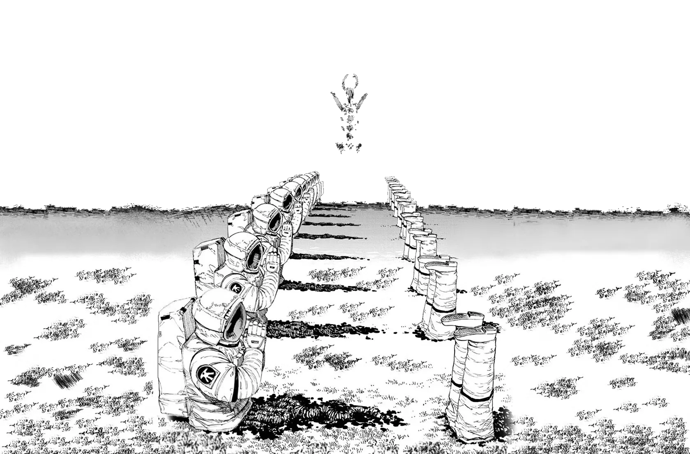

# 
DHARMA&nbsp;&nbsp;&nbsp;धर्म

<b>The universal truth common to all individuals at all times.</b>

 

“You cannot be governed; you just didn’t realize it yet.”

— <a href="http://nowherejezfoltodf4jiyl6r56jnzintap5vyjlia7fkirfsnfizflqd.onion/index.html">Nowhere Community</a>

 
## Welcome to DHARMA
This is my personal webpage which serves to be an extension of my inner thoughts.
I haven been wanting to write a diary for the longest time but it always felt like a daunting task.
This place exists to be a not so personal diary of me where I write about the things I learn and experience without worrying about censorship.

### Nature of content you will find here !

At some point in your life, you have invariably felt it. There is poison that is being spilled all around the world, straight into your mind. It has been changing everyone around you, it may have started to change you as well.

But why is nobody talking about it? Why is nobody naming it, calling it out? Why is nobody questioning its existence, or it's authority?

The mind poisoning of mankind is real, it has become efficient, it has become convenient, and even worshiped.

Science can help everyone understand the true nature of [reality](reality.md), and in turn everything else.

But the individual has to be willing to accept the reality, it must come from their own individual will, you cannot force them from the outside, it has to come from within them. 

 

  

    <!-- Window controls -->
    

      <button class="terminal-control terminal-minimize"
              aria-label="Minimize"
              title="Minimize">−</button>

      <button class="terminal-control terminal-maximize"
              aria-label="Maximize"
              title="Maximize">□</button>

      <button class="terminal-control terminal-close"
              aria-label="Close"
              title="Close">×</button>
    

    <!-- Normal terminal -->
    

      

        user@dharma:~$
        cat Featured_Article.txt
      

      

        $
        <a href="./panopticon" class="terminal-link">
          You are a Commodity
        </a>
      

      

        user@dharma:~$
        
      

    

    <!-- Maximized terminal content -->
    

      

        user@dharma:~$
        tree
      

      <pre class="tree-output">.
└── dharma
    ├── docs
    │   ├── *.md                 # Articles/topics
    │   ├── blog/                # Blog + posts
    │   ├── img/                 # Images
    │   ├── resources/           # Books + surveillance PDFs
    │   ├── javascripts/         # Site JS
    │   └── stylesheets/         # CSS
    ├── mkdocs.yml               # MkDocs config
    └── site/                    # Generated static website
        ├── */index.html         # Built pages
        ├── assets/              # JS/CSS/search assets
        ├── img/                 # Built images
        └── resources/           # Built PDFs/resources

      

        user@dharma:~$
        
      

    

  

