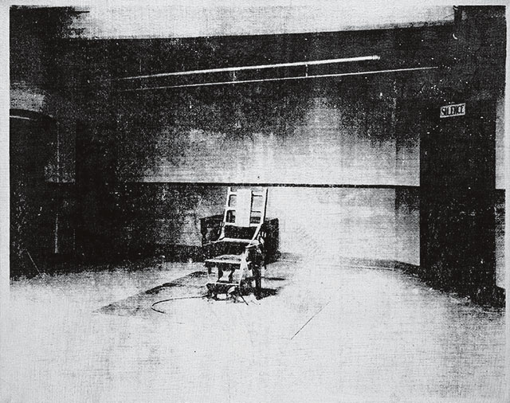

# Effacing Empathy
 
 *2026-10-10* 
 
When the Epstein case was still hot in the beginning of 2026, my friend told me how social media psyops have turned it all into a funny buisness when it was far from it. 
By flooding the platforms with lot of jokes and memes, the people grew numb to it or insensitized as he put it. 

Seven months later today, my newspaper reports on how U.S. military plans to livestream an execution of a convicted criminal by the firing squad and it felt like such an unpresidented development that I had to write about it.

Pentagon chief Peter Hegseth justified the act by stating that people need to understand that there are serious consequences to their actions even when the UN condemned the execution method for amounting to torture.

### Old Sparky

  
*Little Electric Chair by Andy Warhol*
  
 
  

>“When you see a gruesome picture over and over again, it doesn’t really have any effect.” 

 
 ~*Andy Warthol* 
 
 
Little Electric Chair depicts a chair dubbed ‘Old Sparky’ at the Sing Sing penitentiary in New York with a. While the dark and grainy texture creates a foreboding mood, the actual content of the image is fairly unassuming; an empty chair in a room. However, when the piece is contextualized with its name and history, the terror and intent of the paintings is revealed. The fact that the subject is not an imaginary or ancient device, but a real, modern instrument for killing, invokes a harsh realization and a sense of panic. The reality that people have died in this chair gives the piece its weight.

 A main rationale for capital punishment is deterrence, exploiting self-preservation to prevent crime. 

### Exploiting human psychology

As seen in [understanding reality](reality.md#various-bias) section, human psychology is fragile and judgements waver easily. Today's powers utilize very sophisticated propaganda technique which exploits human psychology.

**Consensus spoofing** is one such technique and it has been demonstrated in countless experiments that if I'm sitting in a room with several other people who all say something that doesn't seem true to me but they're all insisting that it's true then I'm going to be influenced by that. 

So if you can manipulate the apparent consensus, you can make people doubt their beliefs. At a maximum, you can make people change their beliefs and at a minimum, you can make people shut up.
 
### Social media opened new frontiers for manipualrion

 Before [social media](panopticon.md#Addiction) came, one way to manipulate reality was censorship. The government would have the gatekeepers and threaten to prosecute or shutdown the outlets if they disagreed.

Social media came and started doing the opposite of censorship. You can now drown people in the sea of information. You can make it very difficult or impossible for people telling the truth to get attention by doing what Steve Bannon called flooding the zone with shit. 

  

 
 *Putin by Robert Kuzovkov who was executed for criticisizing him but I think they should have let him cook his shit for its not much different from what they do (incesitize evil stuff)* 
 
 
This technique is called **fire hose of falsehood** and is central to many disinformation campaigns, originally pioneered by the Russians who are still its best practitioners. 

The goal is not to put out a single false narrative and persuade people. It's to put out such a deluge of false narratives of lies, halftruths, exaggeration, and conspiracy theories that people can't tell what's up anymore. They can't tell what's true, what's false. They become cynical fatalistic. And when they're cynical and fatalistic, they become passive and they stay home. That's how Putin has manipulated the Russian population.

President Donald Trump also understood that if you say something false often enough, it will sink in. And in fact, just making people refute it will make it sink in even more. Saying enough self- contradictory things at a fast enough clip makes people lose their orientation to reality altogether. He understands another propaganda tactic which is called reversal.

**Reversal propaganda** is a tactic in which the propagandist portrays the victim as the oppressor and the oppressor as the victim, inverting reality to manipulate public perception.

Trump's MAGA movement has been instrumental in detaching American masses from reality. It has also inspired ruling bodies of other countries to use similar tactics.

We're seeing so much shit happen again and again and these are not the hallmark of liberal democracies, its fascism.

